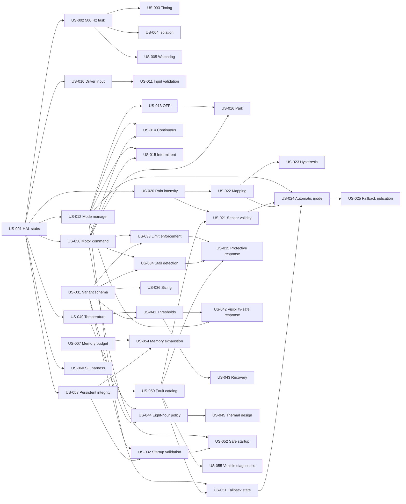

# User Stories: Rain-Adaptive Wiper Control System

**Source:** `docs/wiper_control_system_product_requirements.md` (v1.0, Draft for engineering review)
**Purpose:** Story backlog for per-story requirement analysis. Each story is sized S/M/L, independently testable, and lists its dependencies.
**Status:** Draft. Not approved. No story contains calibrated or approved limits; all numeric values are `TBD` until supplied by engineering (AGENTS.md Section 3).

---

## 1. Conventions

### 1.1 Size Definition (S / M / L only)

| Size | Meaning |
|---|---|
| **S** | One component or one decision rule. One interface. Up to about 4 acceptance criteria. Few unknowns. |
| **M** | One component with state or several rules. Up to 2 interfaces. About 5 to 8 acceptance criteria. Some unknowns. |
| **L** | Several interacting rules or components, or a major open decision. More than 8 acceptance criteria. Must be split in analysis if it grows further. |

Anything larger than L has been split. If requirement analysis shows a story exceeds L, split it rather than adding a new size.

### 1.2 Dependency Types

| Term | Meaning |
|---|---|
| **Depends on (hard)** | The interface or data this story consumes must exist (real or stub) before the story can be built. |
| **Related (soft)** | Shares data or behavior but does not block build or test. |
| **Blocked by decision** | An open question from PRD Section 12 (`Q1` to `Q11`) that must be answered to finish analysis. |

### 1.3 Independent Testability Rule

Every story is tested in isolation by replacing its hard dependencies with stubs or simulators at the HAL or interface boundary (see US-001). A story is only "done" when its own acceptance criteria pass with stubs. Integration with real dependencies is covered by US-060 and US-061.

### 1.4 Story Template (used for every story)

- **Trace:** PRD requirement IDs and VV test IDs.
- **Depends on (hard) / Related (soft) / Blocked by decision.**
- **Story:** As a ... I want ... so that ...
- **In scope / Out of scope.**
- **Acceptance criteria:** Observable, testable statements. `TBD` means value comes from approved data.
- **Independent test approach:** Stubs and inputs used.
- **Analysis notes:** Questions and risks to resolve during requirement analysis.

---

## 2. Backlog Summary

| ID | Epic | Title | Size | Hard dependencies | PR trace |
|---|---|---|---|---|---|
| US-001 | Platform | HAL interfaces and simulation stubs | M | none | PR-022, PR-030 |
| US-002 | Platform | 500 Hz control task scheduling | M | US-001 | PR-020 |
| US-003 | Platform | Execution-time measurement and timing diagnostics | M | US-002 | PR-021, PR-027 |
| US-004 | Platform | Lower-priority workload isolation | M | US-002 | PR-025, PR-034 |
| US-005 | Platform | Watchdog supervision and overrun/lockup/reset response | M | US-002 | PR-026 |
| US-006 | Platform | MCU selection evaluation | M | none | PR-023, PR-024 |
| US-007 | Platform | Memory budget definition and monitoring | S | none | PR-031 |
| US-010 | Driver | Driver input acquisition, debounce and filtering | M | US-001 | PR-007 |
| US-011 | Driver | Driver input validation and plausibility | S | US-010 | PR-006 |
| US-012 | Driver | Mode manager state machine and priority arbitration | M | US-001 | PR-005 |
| US-013 | Driver | OFF mode and wipe inhibit | S | US-012 | PR-001, PR-005 |
| US-014 | Driver | Manual continuous mode | S | US-012, US-030 | PR-002 |
| US-015 | Driver | Manual intermittent mode with configurable interval | M | US-012, US-030 | PR-003 |
| US-016 | Driver | Safe park sequence | M | US-013, US-030 | PR-005 |
| US-020 | Rain | Rain-sensor acquisition and intensity level | M | US-001 | PR-010 |
| US-021 | Rain | Rain-sensor validity diagnostics | M | US-020, US-050 | PR-013 |
| US-022 | Rain | Calibrated intensity-to-wipe mapping | M | US-020 | PR-011, PR-015 |
| US-023 | Rain | Hysteresis, filtering and transition control | M | US-022 | PR-012 |
| US-024 | Rain | Automatic mode with sensor fallback | M | US-012, US-021, US-022, US-051 | PR-004, PR-014 |
| US-025 | Rain | Driver indication of sensor fallback | S | US-024 | PR-014 |
| US-030 | Motor | Motor-driver command interface | M | US-001 | PR-022 |
| US-031 | Motor | Variant parameter schema and S/M/L selection | M | none | PR-040, PR-041 |
| US-032 | Motor | Startup configuration validation | M | US-031, US-053 | PR-046 |
| US-033 | Motor | Speed, current and torque limit enforcement | L | US-030, US-031 | PR-042, PR-043 |
| US-034 | Motor | Stall and overload detection | M | US-030, US-031 | PR-044 |
| US-035 | Motor | Overload and stall protective response | M | US-033, US-034, US-050 | PR-045 |
| US-036 | Motor | Motor and linkage sizing verification | M | US-031 | PR-047 |
| US-040 | Thermal | Temperature monitoring or thermal model | M | US-001 | PR-052 |
| US-041 | Thermal | Calibrated thermal thresholds and derating | M | US-040, US-031 | PR-054 |
| US-042 | Thermal | Visibility-safe thermal response | M | US-041, US-012 | PR-051, PR-055 |
| US-043 | Thermal | Thermal recovery conditions | S | US-041 | PR-056 |
| US-044 | Thermal | Eight-hour duty-cycle policy | L | US-040, US-031 | PR-050, PR-051 |
| US-045 | Thermal | Thermal design adequacy assessment | S | US-044 | PR-053 |
| US-050 | Diagnostics | Fault catalog and event recording | M | US-053 | PR-060, PR-061 |
| US-051 | Diagnostics | Fallback state management | M | US-012, US-050 | PR-062 |
| US-052 | Diagnostics | Safe startup, reset and brownout behavior | M | US-030, US-032 | PR-063 |
| US-053 | Diagnostics | Persistent settings integrity and versioning | M | US-001 | PR-033 |
| US-054 | Diagnostics | Memory exhaustion and corrupted-data handling | S | US-007, US-053 | PR-032 |
| US-055 | Diagnostics | Vehicle-interface diagnostic reporting | M | US-050 | PR-064 |
| US-060 | Verification | SIL test harness with simulated plant | L | US-001 | VV-001 to VV-010 |
| US-061 | Verification | Target integration and VV execution | L | all functional stories | PR-030, VV-001 to VV-010 |

Totals: 7 stories in Platform, 7 in Driver, 6 in Rain, 7 in Motor, 6 in Thermal, 6 in Diagnostics, 2 in Verification (41 stories). Size mix: S = 8, M = 29, L = 4.

---

## 3. Dependency Overview

Not shown for clarity: US-006 and US-007 have no hard dependencies. US-061 depends on all functional stories.

### 3.1 Suggested Build Waves (by dependency only)

| Wave | Stories |
|---|---|
| 0 (no dependencies) | US-001, US-006, US-007, US-031 |
| 1 | US-002, US-010, US-012, US-020, US-030, US-040, US-053, US-036, US-060 |
| 2 | US-003, US-004, US-005, US-011, US-013, US-022, US-014, US-015, US-032, US-033, US-034, US-041, US-044, US-050, US-054 |
| 3 | US-016, US-021, US-023, US-035, US-042, US-043, US-045, US-051, US-052, US-055 |
| 4 | US-024, US-025 |
| 5 | US-061 |

---

## 4. Blocking Open Decisions (PRD Section 12)

| Decision | Question | Stories affected |
|---|---|---|
| Q1 | Supply voltage and electrical architecture | US-030, US-033, US-052 |
| Q2 | Rain sensor type, interface, rate, diagnostics | US-020, US-021, US-022 |
| Q3 | Scope of the 500 Hz rate (assumed: control task) | US-002, US-003 |
| Q4 | S/M/L lengths, motor part numbers, ratings, linkage loads | US-031, US-032, US-033, US-034, US-036, US-041 |
| Q5 | Availability of park, current, temperature feedback | US-016, US-033, US-034, US-040 |
| Q6 | Driver controls and modes | US-010, US-011, US-012, US-014, US-015 |
| Q7 | Fallback when rain sensor fails | US-021, US-024, US-025 |
| Q8 | Meaning of the eight-hour limit and visibility policy | US-042, US-044, US-045 |
| Q9 | Hosted application CPU, RAM, flash, scheduling needs | US-004, US-006, US-007 |
| Q10 | Vehicle interface and diagnostic protocol | US-025, US-055 |
| Q11 | Environmental, safety, cybersecurity, regulatory allocation | US-005, US-050, US-051, US-052 |

---

# 5. Epic: Platform and Real-Time (E1)

## US-001: HAL interfaces and simulation stubs

- **Size:** M
- **Trace:** PR-022, PR-030 (enabler for all stories)
- **Depends on (hard):** none
- **Related (soft):** US-006 (MCU choice affects BSP, not HAL interface)
- **Blocked by decision:** none for interface; Q5 for the list of feedback channels
- **Story:** As a software engineer, I want MCU-independent HAL interfaces with host-side simulation stubs so that every other story can be built and tested without target hardware or a selected MCU.
- **In scope:** HAL interfaces for GPIO, ADC, PWM/timer, watchdog, NVM, communication, motor driver, current and temperature feedback, time base. Stub and fault-injectable implementations.
- **Out of scope:** BSP for a specific Renesas or TI device. Application logic.
- **Acceptance criteria:**
  1. Each interface is a documented header with units, scaling and valid ranges.
  2. Application code compiles against the HAL with no direct register access.
  3. A stub exists for every interface and can inject: stuck, out-of-range, stale and missing values.
  4. A stub time base allows deterministic stepping of 2 ms ticks.
  5. A motor-driver stub records every command it receives.
- **Independent test approach:** Host build with unit tests calling each stub; verify injection and recording behavior.
- **Analysis notes:** Decide whether feedback channels are optional in the interface (affects PR-044 and PR-033 "where available" wording).

## US-002: 500 Hz control task scheduling

- **Size:** M
- **Trace:** PR-020, VV-004
- **Depends on (hard):** US-001 (time base)
- **Related (soft):** US-003, US-005
- **Blocked by decision:** Q3
- **Story:** As a control engineer, I want a designated high-priority task released every 2 ms so that sensing and control run at a deterministic rate.
- **In scope:** Task release, priority assignment, period configuration, jitter measurement hook, bounded task body skeleton (input, control, output phases).
- **Out of scope:** Content of control logic. WCET margin (US-003).
- **Acceptance criteria:**
  1. Task period is 2 ms nominal.
  2. Measured period jitter stays within a limit `TBD` (to be approved).
  3. The task body contains no blocking calls, dynamic allocation, or unbounded loops (review checklist).
  4. Task phases run in a fixed order each cycle.
  5. Missed release is detected and counted.
- **Independent test approach:** Simulated time base; run N cycles; check release times and order. Target measurement deferred to US-061.
- **Analysis notes:** Confirm what the 500 Hz task contains (sensing only, or sensing plus control plus PWM update).

## US-003: Execution-time measurement and timing diagnostics

- **Size:** M
- **Trace:** PR-021, PR-027, VV-004
- **Depends on (hard):** US-002
- **Related (soft):** US-050 (fault recording), US-004
- **Blocked by decision:** Q3, Q9 (worst-case workload definition)
- **Story:** As a test engineer, I want per-cycle execution time measured and timing faults exposed so that I can show the 2 ms deadline and margin are met under worst-case load.
- **In scope:** Start/finish timestamps, maximum observed time, deadline-miss count, overrun flag, stack high-water mark where supported, development and (where feasible) production exposure.
- **Out of scope:** Static WCET tooling selection. Reaction to overrun (US-005).
- **Acceptance criteria:**
  1. Maximum and last execution time are available per cycle.
  2. A forced overrun in a stub sets the overrun flag and increments the counter.
  3. Deadline margin is compared against an approved value `TBD`.
  4. Reporting adds no blocking operation to the task.
  5. Average-only measurement is rejected as insufficient evidence.
- **Independent test approach:** Inject artificial delays into the task body via stub; confirm detection.
- **Analysis notes:** Define "approved timing margin" and "defined worst-case workload".

## US-004: Lower-priority workload isolation

- **Size:** M
- **Trace:** PR-025, PR-034, VV-005
- **Depends on (hard):** US-002
- **Related (soft):** US-007, US-003
- **Blocked by decision:** Q9
- **Story:** As a system architect, I want optional and lower-priority functions isolated by scheduling and resource limits so that they cannot delay the control task.
- **In scope:** Priority and preemption configuration, bounded execution budgets for lower-priority tasks, interrupt-latency bounds, shared-resource access rules (no priority-inversion blocking).
- **Out of scope:** Defining the hosted application itself (Q9).
- **Acceptance criteria:**
  1. With a lower-priority task at maximum load, no deadline miss occurs in the 500 Hz task.
  2. Shared resources used by both have bounded, non-blocking access.
  3. A lower-priority task exceeding its budget is detected and contained.
  4. Interrupt load at maximum supported rate does not cause a miss.
- **Independent test approach:** Synthetic load tasks and interrupt generators on the simulated scheduler.
- **Analysis notes:** Needs the workload list from Q9. Without it, use a labelled synthetic worst-case load.

## US-005: Watchdog supervision and overrun/lockup/reset response

- **Size:** M
- **Trace:** PR-026, VV-009
- **Depends on (hard):** US-002
- **Related (soft):** US-052 (startup after reset), US-050
- **Blocked by decision:** Q11 (safety allocation of watchdog)
- **Story:** As a safety engineer, I want watchdog servicing tied to healthy task execution so that lockups and overruns lead to a defined safe response.
- **In scope:** Watchdog service only after verified healthy cycle, window or timeout configuration, reaction to overrun and lockup, reset-cause capture.
- **Out of scope:** Startup motor-inhibit logic (US-052).
- **Acceptance criteria:**
  1. Watchdog is serviced only when the cycle completes within its deadline.
  2. A simulated lockup causes watchdog reset within the approved time `TBD`.
  3. A task overrun triggers the defined reaction (document: limit, log, or reset).
  4. Reset cause is captured and available for diagnostics.
  5. Motor outputs go to the safe state when the watchdog expires.
- **Independent test approach:** Watchdog stub with fault injection of missed service and overrun.
- **Analysis notes:** Define the fault-tolerant time interval (needs the safety concept).

## US-006: MCU selection evaluation

- **Size:** M
- **Trace:** PR-023, PR-024
- **Depends on (hard):** none
- **Related (soft):** US-003 (WCET data), US-007 (memory budget), US-004
- **Blocked by decision:** Q2, Q3, Q5, Q9, Q11
- **Story:** As a system architect, I want a documented comparison of candidate Renesas and TI MCUs against PRD Section 9 criteria so that the selection is traceable and not assumed.
- **In scope:** Criteria matrix, weighting, evidence per candidate, recommendation record.
- **Out of scope:** Mandating a part number before inputs exist. BSP implementation.
- **Acceptance criteria:**
  1. Every PRD Section 9 criterion has a pass/fail or score with a cited datasheet reference.
  2. CPU, RAM, flash headroom is calculated from the approved budgets.
  3. Required peripherals (PWM, ADC, communication, watchdog, brownout) are mapped to resources.
  4. Automotive temperature range, qualification, lifecycle are recorded.
  5. The decision record names approvers.
- **Independent test approach:** Design review with checklist (verification is Review).
- **Analysis notes:** No datasheet values may be guessed; missing data becomes an open issue.

## US-007: Memory budget definition and monitoring

- **Size:** S
- **Trace:** PR-031
- **Depends on (hard):** none
- **Related (soft):** US-006, US-054
- **Blocked by decision:** Q9
- **Story:** As a software architect, I want RAM and flash budgets defined per category and checked in the build so that usage stays within approved limits.
- **In scope:** Budget table (code, stack, heap if used, calibration, diagnostics, persistent settings), build-time map-file check, stack usage report.
- **Out of scope:** Runtime exhaustion handling (US-054).
- **Acceptance criteria:**
  1. Budget values are recorded per category (values `TBD` until approved).
  2. The build fails when a category exceeds its budget.
  3. Stack worst-case usage is reported.
  4. No dynamic allocation exists in the real-time path (static analysis result).
- **Independent test approach:** Build script check against a sample map file with injected overflow.
- **Analysis notes:** Whether heap is used at all.

---

# 6. Epic: Driver Input and Modes (E2)

## US-010: Driver input acquisition, debounce and filtering

- **Size:** M
- **Trace:** PR-007, VV-001
- **Depends on (hard):** US-001
- **Related (soft):** US-011
- **Blocked by decision:** Q6
- **Story:** As a driver, I want my switch and dial selections read reliably so that the wipers respond promptly without chatter.
- **In scope:** Reading switch positions and intermittent/sensitivity input, debounce, filtering, timestamping, output of a `DriverRequest` data item.
- **Out of scope:** Plausibility rejection (US-011). Mode logic (US-012).
- **Acceptance criteria:**
  1. A contact bounce shorter than the debounce time `TBD` produces no mode change.
  2. A stable change is reported within the response time `TBD`.
  3. Filtering never exceeds the approved response-time budget.
  4. Each `DriverRequest` carries a timestamp and validity flag.
  5. Behavior at exactly the debounce boundary is defined and tested.
- **Independent test approach:** Stub GPIO/ADC with scripted bounce patterns.
- **Analysis notes:** Switch hardware type (analog ladder, discrete, network message) drives the filter design.

## US-011: Driver input validation and plausibility

- **Size:** S
- **Trace:** PR-006
- **Depends on (hard):** US-010
- **Related (soft):** US-050
- **Blocked by decision:** Q6
- **Story:** As a safety engineer, I want invalid or contradictory driver inputs rejected or safely handled so that they never create an unintended wipe command.
- **In scope:** Out-of-range, contradictory (for example OFF and continuous simultaneously), noisy, missing input detection and defined handling.
- **Out of scope:** Debounce (US-010).
- **Acceptance criteria:**
  1. Each invalid pattern maps to a documented handling result (hold last valid, treat as OFF, or fault).
  2. An invalid input never produces motor activation by itself.
  3. A missing input is detected within `TBD` time.
  4. Each rejection raises a diagnostic event (through a stubbed fault interface).
- **Independent test approach:** Table-driven tests with all contradictory input combinations.
- **Analysis notes:** Choose the safe default, which needs the safety concept.

## US-012: Mode manager state machine and priority arbitration

- **Size:** M
- **Trace:** PR-005, VV-001
- **Depends on (hard):** US-001 (types and time base only)
- **Related (soft):** US-010, US-011, US-051
- **Blocked by decision:** Q6
- **Story:** As a control engineer, I want an explicit state machine with a deterministic priority order so that driver commands, automatic requests and faults always resolve the same way.
- **In scope:** States per AGENTS.md 5.2 (INIT, OFF, PARKING, MANUAL_CONTINUOUS, MANUAL_INTERMITTENT, AUTOMATIC, DERATED, FAULT_FALLBACK, SAFE_STOP), transition table, priority order, handling of simultaneous requests, handling of invalid enum values.
- **Out of scope:** Mode-specific behavior details (US-013 to US-016, US-024). Fault policy (US-051).
- **Acceptance criteria:**
  1. Every state has defined entry, exit, motor-command behavior.
  2. Every permitted transition is in a table; all others are rejected.
  3. Simultaneous requests resolve per documented priority; driver OFF ranks above automatic.
  4. Invalid state or request values lead to a safe state, not undefined behavior.
  5. Transition coverage is 100 percent in unit tests.
- **Independent test approach:** Inject `DriverRequest`, rain request, and fault flags as plain data; check output state and motor request.
- **Analysis notes:** Priority between fault, thermal, and driver requests needs explicit approval.

## US-013: OFF mode and wipe inhibit

- **Size:** S
- **Trace:** PR-001, PR-005, VV-001
- **Depends on (hard):** US-012
- **Related (soft):** US-016
- **Blocked by decision:** Q5 (park behavior)
- **Story:** As a driver, I want OFF to stop wiping so that wipers never start by themselves when I have turned them off.
- **In scope:** OFF selection from every active state, inhibit of new wipe requests including automatic.
- **Out of scope:** Park sequence content (US-016).
- **Acceptance criteria:**
  1. OFF from each active state results in no new wipe command.
  2. An automatic rain request while OFF is ignored.
  3. A wipe already in progress follows the documented stop or park behavior.
  4. OFF is honored within the response time `TBD`.
- **Independent test approach:** State-machine test from each state with a rain-request stub.
- **Analysis notes:** Define "new wipe" versus "wipe in progress".

## US-014: Manual continuous mode

- **Size:** S
- **Trace:** PR-002, VV-001
- **Depends on (hard):** US-012, US-030
- **Related (soft):** US-033
- **Blocked by decision:** Q6, Q4 (continuous speed setting)
- **Story:** As a driver, I want continuous wiping at the selected setting so that I can clear the windshield on demand.
- **In scope:** Continuous request generation at the approved continuous speed setting(s).
- **Out of scope:** Limit enforcement (US-033).
- **Acceptance criteria:**
  1. Selecting continuous results in a continuous motor request at the approved setting(s) `TBD`.
  2. Leaving continuous stops the request per the OFF or mode-change rule.
  3. The request is independent of rain-sensor status (including invalid).
  4. The motor-command stub receives requests only within the configured setting range.
- **Independent test approach:** Mode manager with motor-command stub.
- **Analysis notes:** Number of continuous speeds (low and high?) is unknown.

## US-015: Manual intermittent mode with configurable interval

- **Size:** M
- **Trace:** PR-003, VV-001
- **Depends on (hard):** US-012, US-030
- **Related (soft):** US-010
- **Blocked by decision:** Q6
- **Story:** As a driver, I want to set the delay between wipes so that I can match light or variable rain.
- **In scope:** Interval selection mapping, interval timer, wipe trigger, interval change during pause, minimum and maximum bounds.
- **Out of scope:** Automatic interval from rain (US-022).
- **Acceptance criteria:**
  1. Wipes occur at the selected interval within tolerance `TBD`.
  2. Minimum, nominal, and maximum intervals are tested.
  3. Changing the interval during a pause applies the documented rule (restart or finish current).
  4. Invalid interval values are clamped or rejected per the documented rule.
  5. Interval timing is derived from the 2 ms tick without drift beyond tolerance.
- **Independent test approach:** Stub time base stepping; count wipe triggers.
- **Analysis notes:** Interval range and steps are unspecified.

## US-016: Safe park sequence

- **Size:** M
- **Trace:** PR-005, PR-063 (partial), VV-001
- **Depends on (hard):** US-013, US-030
- **Related (soft):** US-052, US-035
- **Blocked by decision:** Q5
- **Story:** As a driver, I want the wipers to return to the park position after I turn them off so that they do not rest in my field of view.
- **In scope:** Park sequence when OFF arrives mid-cycle, park detection (feedback or time-based fallback), timeout, interaction with faults.
- **Out of scope:** Initial homing at startup if not required by the design (analysis decision).
- **Acceptance criteria:**
  1. OFF mid-cycle completes park and then de-energizes the motor.
  2. Park completion is detected using the available feedback.
  3. A park timeout leads to the documented response and a diagnostic event.
  4. Park does not start a new wipe request.
  5. If park feedback is missing, the documented fallback is applied.
- **Independent test approach:** Park-position stub with scripted timing, including never reaching park.
- **Analysis notes:** Whether the vehicle requires a park sequence at all (PR-005 says "if required").

---

# 7. Epic: Rain Sensing and Adaptive Control (E3)

## US-020: Rain-sensor acquisition and intensity level

- **Size:** M
- **Trace:** PR-010, VV-002
- **Depends on (hard):** US-001
- **Related (soft):** US-021, US-022
- **Blocked by decision:** Q2
- **Story:** As a control engineer, I want raw rain-sensor data converted into a calibrated intensity level so that downstream logic works with a stable, defined quantity.
- **In scope:** Sensor read, scaling, timestamping, intensity levels (no rain, light, medium, heavy) with thresholds from calibration.
- **Out of scope:** Hysteresis (US-023), validity (US-021), mapping to wipe (US-022).
- **Acceptance criteria:**
  1. Raw sensor input maps to an intensity level per calibration table `TBD`.
  2. Every output carries timestamp and raw value.
  3. Each level boundary is tested at, below, and above threshold.
  4. Sensor sample rate matches the interface specification.
- **Independent test approach:** ADC or communication stub with a sweep of values.
- **Analysis notes:** Sensor type and range unknown. Defining the "no rain" level.

## US-021: Rain-sensor validity diagnostics

- **Size:** M
- **Trace:** PR-013, VV-003
- **Depends on (hard):** US-020, US-050 (event interface, stub allowed)
- **Related (soft):** US-024
- **Blocked by decision:** Q2, Q7
- **Story:** As a safety engineer, I want stale, out-of-range, implausible and missing sensor data detected so that invalid data never drives the motor.
- **In scope:** Stale-data timeout, range check, frozen-value check, disconnect detection, plausibility rules, debounce of fault confirmation and recovery.
- **Out of scope:** Fallback behavior (US-024).
- **Acceptance criteria:**
  1. Each failure type (stale, out of range, frozen, disconnected, implausible) sets a distinct validity status.
  2. Detection time for each type is within `TBD`.
  3. Confirmation and healing times are defined and tested.
  4. A single noisy sample does not set a fault.
  5. The validity status is available to the mode manager as data.
- **Independent test approach:** Sensor stub with scripted failure patterns.
- **Analysis notes:** Whether frozen-value detection is feasible for this sensor.

## US-022: Calibrated intensity-to-wipe mapping

- **Size:** M
- **Trace:** PR-011, PR-015, VV-002
- **Depends on (hard):** US-020
- **Related (soft):** US-053 (calibration storage), US-031 (limits on speed)
- **Blocked by decision:** Q2, Q4
- **Story:** As a driver, I want wipe interval or speed to follow rain intensity so that visibility is maintained without manual adjustment.
- **In scope:** Calibration table (intensity to interval and/or speed), range checks on table values, no direct use of raw intensity as speed.
- **Out of scope:** Hysteresis and filtering (US-023).
- **Acceptance criteria:**
  1. Each intensity level maps to the calibrated interval and/or speed.
  2. Output never exceeds the variant limits (checked through the limit interface in US-033, stubbed here).
  3. A calibration table with out-of-range or non-monotonic values is rejected.
  4. A review confirms no path uses sensor intensity directly as a motor command.
  5. Mapping data is separate from logic and carries a version.
- **Independent test approach:** Level sweep with a table fixture (synthetic labelled data).
- **Analysis notes:** Calibration values are not available; use only synthetic test data.

## US-023: Hysteresis, filtering and transition control

- **Size:** M
- **Trace:** PR-012, VV-002
- **Depends on (hard):** US-022
- **Related (soft):** US-020
- **Blocked by decision:** Q2
- **Story:** As a driver, I want stable wiping behavior in changing rain so that the wiper does not rapidly switch speeds.
- **In scope:** Threshold hysteresis, persistence time, filtering, rate limiting between levels, behavior at threshold edges.
- **Out of scope:** Mapping table itself (US-022).
- **Acceptance criteria:**
  1. A signal oscillating within the hysteresis band causes no level change.
  2. A level change requires the persistence time `TBD`.
  3. Transitions respect the rate limit `TBD`.
  4. Crossing in both directions is tested at each threshold.
  5. Filtering delay is within the response-time budget.
- **Independent test approach:** Replay noisy intensity series (synthetic) and count level changes.
- **Analysis notes:** Asymmetric response (fast up, slow down) may be required.

## US-024: Automatic mode with sensor fallback

- **Size:** M
- **Trace:** PR-004, PR-014, VV-002, VV-003
- **Depends on (hard):** US-012, US-021, US-022, US-051
- **Related (soft):** US-023, US-025
- **Blocked by decision:** Q7
- **Story:** As a driver, I want automatic wiping that remains safe when the rain sensor fails so that I never get uncontrolled wiping.
- **In scope:** Automatic state behavior with valid data, transition to fallback on invalid data, recovery rule, interaction with driver OFF.
- **Out of scope:** Fallback state infrastructure (US-051), driver indication (US-025).
- **Acceptance criteria:**
  1. With valid data, wipe behavior follows the mapping.
  2. On invalid or stale data, the system enters the approved fallback `TBD` and no direct motor command results from the bad data.
  3. Recovery occurs only after the defined healing time.
  4. Driver OFF during fallback is honored.
  5. Transition in and out of automatic from each manual mode is tested.
- **Independent test approach:** Rain-data and validity stubs into the mode manager.
- **Analysis notes:** Fallback options: continuous, a fixed intermittent, or stop. This needs safety approval.

## US-025: Driver indication of sensor fallback

- **Size:** S
- **Trace:** PR-014
- **Depends on (hard):** US-024
- **Related (soft):** US-055
- **Blocked by decision:** Q7, Q10
- **Story:** As a driver, I want to know when automatic mode is degraded so that I can switch to manual operation.
- **In scope:** Indication request through the available vehicle interface (signal, lamp, or message), clearing of the indication.
- **Out of scope:** Interface protocol definition.
- **Acceptance criteria:**
  1. Entering fallback sets the indication request.
  2. Leaving fallback clears it.
  3. If no interface supports it, the behavior is documented and no error occurs.
  4. Indication logic never blocks the 500 Hz task.
- **Independent test approach:** Output-interface stub.
- **Analysis notes:** Depends on the interface chosen (Q10).

---

# 8. Epic: Motor Variants and Drive Limits (E4)

## US-030: Motor-driver command interface

- **Size:** M
- **Trace:** PR-022, VV-006
- **Depends on (hard):** US-001
- **Related (soft):** US-033
- **Blocked by decision:** Q1, Q4 (driver part)
- **Story:** As a control engineer, I want one bounded command interface to the motor driver so that all modes command the motor through a single, checkable path.
- **In scope:** Command structure (enable, direction if needed, speed or duty), saturation and plausibility checks, default de-energized output, driver enable gating.
- **Out of scope:** Variant-specific limits (US-033).
- **Acceptance criteria:**
  1. The only path to the HAL motor output is this interface.
  2. Out-of-range commands are saturated and flagged.
  3. The default and reset state is de-energized.
  4. Commands update at the control-task rate.
  5. A driver-fault feedback input, if present, forces the safe output.
- **Independent test approach:** Motor-driver stub records commands; fuzz command values.
- **Analysis notes:** Driver type (H-bridge, brushed, brushless) is unknown.

## US-031: Variant parameter schema and S/M/L selection

- **Size:** M
- **Trace:** PR-040, PR-041, VV-006
- **Depends on (hard):** none
- **Related (soft):** US-032, US-053
- **Blocked by decision:** Q4
- **Story:** As a calibration engineer, I want an approved, versioned parameter set per S, M, L variant so that every limit comes from data and not from the label.
- **In scope:** Parameter schema (PRD Section 8 plus AGENTS.md Section 7 additions), variant selection mechanism, version and ID fields, units and scaling.
- **Out of scope:** Validation at startup (US-032). Actual limit enforcement (US-033).
- **Acceptance criteria:**
  1. Schema covers: linkage length, voltage range, rated and maximum torque, speed, continuous and peak current, stall current limit and response, temperature range, duty cycle, thermal thresholds, driver part number.
  2. Selecting S, M, or L loads only that variant's parameters.
  3. No parameter value is hard-coded outside the data set.
  4. A missing parameter blocks the variant from being marked approved.
  5. Values in repository are clearly marked synthetic or approved.
- **Independent test approach:** Schema unit tests with synthetic data sets.
- **Analysis notes:** All values are `TBD` in the PRD. Delivery of real data is a prerequisite for production.

## US-032: Startup configuration validation

- **Size:** M
- **Trace:** PR-046, PR-033, VV-006, VV-009
- **Depends on (hard):** US-031, US-053
- **Related (soft):** US-052, US-050
- **Blocked by decision:** Q4
- **Story:** As a safety engineer, I want the selected configuration validated at startup so that invalid data never enables unrestricted motor operation.
- **In scope:** ID, version, CRC, range, compatibility, cross-parameter checks, inhibit and fallback on failure, diagnostic event.
- **Out of scope:** Persistent storage mechanics (US-053).
- **Acceptance criteria:**
  1. A valid S, M, L set loads and is flagged valid.
  2. Invalid ID, version, CRC, range, or inconsistent limits each cause rejection.
  3. On rejection, normal motor operation is inhibited and fallback is entered.
  4. A diagnostic event is recorded for each rejection reason.
  5. Unsupported variant selection is rejected.
- **Independent test approach:** Corrupted-data fixtures; check outputs and motor stub stays off.
- **Analysis notes:** How the variant is selected at runtime (hardware strap, NVM, or coding) is unknown.

## US-033: Speed, current and torque limit enforcement

- **Size:** L
- **Trace:** PR-042, PR-043, VV-006, VV-007
- **Depends on (hard):** US-030, US-031
- **Related (soft):** US-035, US-034
- **Blocked by decision:** Q1, Q4, Q5
- **Story:** As a control engineer, I want every motor command bounded by the active variant's limits so that the motor stays inside its specified envelope.
- **In scope:** Limits for speed, current, torque (or equivalent duty), use of feedback where available, operating-envelope check (including supply voltage), behavior when feedback is missing, limit-active indication.
- **Out of scope:** Stall detection (US-034). Protective response (US-035).
- **Acceptance criteria:**
  1. Commands above each limit are saturated at the limit of the active variant.
  2. Boundary values (limit minus one, limit, limit plus one) are tested for each limit and variant.
  3. The commanded point stays inside the motor envelope across the supply range `TBD`.
  4. With required feedback missing, the documented limited mode applies.
  5. With feedback present, measured current above the limit reduces drive.
  6. Limit-active events are recorded.
  7. S, M, L limits are not mixed up (test changing variant at startup).
  8. Enforcement adds no blocking operation to the control task.
- **Independent test approach:** Motor and feedback stubs with synthetic limits per variant.
- **Analysis notes:** Split into per-limit stories if the torque estimate method is complex. Torque may only be inferred from current.

## US-034: Stall and overload detection

- **Size:** M
- **Trace:** PR-044, VV-007
- **Depends on (hard):** US-030, US-031
- **Related (soft):** US-035
- **Blocked by decision:** Q4, Q5
- **Story:** As a safety engineer, I want stall, overload, and abnormal current detected so that the motor is protected and faults are known.
- **In scope:** Detection conditions (current vs time, speed vs command), blanking for start-up inrush, confirmation time, validity when sensing is missing.
- **Out of scope:** Response (US-035).
- **Acceptance criteria:**
  1. Stall current held beyond the confirmation time `TBD` sets the stall flag.
  2. Normal inrush at start does not set the flag.
  3. Abnormal current profiles set an overload flag.
  4. With no current sensing hardware, the function reports "not available" and does not claim detection.
  5. Detection thresholds come from the variant data.
- **Independent test approach:** Current and speed stubs with scripted profiles, including icing/obstruction.
- **Analysis notes:** Distinguish ice, obstruction, and dry glass friction from a true fault (PRD Section 10).

## US-035: Overload and stall protective response

- **Size:** M
- **Trace:** PR-045, VV-007
- **Depends on (hard):** US-033, US-034, US-050
- **Related (soft):** US-012, US-042
- **Blocked by decision:** Q4, Q11
- **Story:** As a driver, I want the system to protect the motor on overload without leaving me without a defined behavior.
- **In scope:** Drive limiting, stop, retry policy, latching, recovery conditions, diagnostic record.
- **Out of scope:** Detection (US-034).
- **Acceptance criteria:**
  1. On detected overload or stall, the defined response (limit, stop, retry) is applied within `TBD` time.
  2. A diagnostic event is stored with technical data only.
  3. Retry count and delay are bounded.
  4. Recovery occurs only under the defined conditions.
  5. Behavior is the same in every active mode.
- **Independent test approach:** Inject the stall flag; check motor stub output and event store.
- **Analysis notes:** Response needs the safety analysis (PRD Section 6).

## US-036: Motor and linkage sizing verification

- **Size:** M
- **Trace:** PR-047
- **Depends on (hard):** US-031
- **Related (soft):** US-034
- **Blocked by decision:** Q1, Q4
- **Story:** As a mechanical and systems engineer, I want motor and linkage sizing verified against worst-case loads so that limits in the data set are valid.
- **In scope:** Load cases: friction, aerodynamic and water load, ice or obstruction, supply voltage, environment. Analysis report per variant.
- **Out of scope:** Mechanical design.
- **Acceptance criteria:**
  1. Each load case has an assumption and a result per variant.
  2. Margins against rated torque and current are stated.
  3. Any variant failing the analysis is reported as an open issue.
  4. The report is reviewed and linked to the parameter data set version.
- **Independent test approach:** Analysis review (Engineering analysis / Test).
- **Analysis notes:** This is an analysis story with a document output, not software.

---

# 9. Epic: Thermal Management and Duty Cycle (E5)

## US-040: Temperature monitoring or thermal model

- **Size:** M
- **Trace:** PR-052, VV-008
- **Depends on (hard):** US-001
- **Related (soft):** US-044, US-041
- **Blocked by decision:** Q5
- **Story:** As a safety engineer, I want motor and driver temperature known, measured or modeled, so that thermal protection acts on valid data.
- **In scope:** Temperature acquisition and plausibility, or a validated thermal model (current and time based) when no sensor exists, validity flag.
- **Out of scope:** Thresholds (US-041).
- **Acceptance criteria:**
  1. A temperature value and validity status are output every cycle or at the defined rate.
  2. Sensor open, short, and out-of-range cases are detected.
  3. When no sensor exists, the model output is compared to reference data within tolerance `TBD`.
  4. Model invalidity sets the validity flag false.
- **Independent test approach:** Temperature stub; model driven by synthetic current profile.
- **Analysis notes:** Choice between sensor and model depends on Q5; model validation needs real data.

## US-041: Calibrated thermal thresholds and derating

- **Size:** M
- **Trace:** PR-054, VV-008
- **Depends on (hard):** US-040, US-031
- **Related (soft):** US-043, US-042
- **Blocked by decision:** Q4
- **Story:** As a control engineer, I want warning, derating, and shutdown thresholds applied from variant data so that protection is calibrated, not hard-coded.
- **In scope:** Threshold comparison with hysteresis, warning flag, derating factor, shutdown request, per-variant thresholds.
- **Out of scope:** Visibility policy (US-042). Recovery (US-043).
- **Acceptance criteria:**
  1. Crossing each threshold produces the corresponding state.
  2. Thresholds are read from the active variant.
  3. Derating reduces the allowed command (through the limit interface).
  4. Threshold ordering (warning < derate < shutdown) is validated.
  5. Invalid temperature data yields the approved response.
- **Independent test approach:** Temperature ramp up and down with a stub.
- **Analysis notes:** Invalid-temperature response needs a decision.

## US-042: Visibility-safe thermal response

- **Size:** M
- **Trace:** PR-051, PR-055, VV-008, VV-010
- **Depends on (hard):** US-041, US-012
- **Related (soft):** US-044, US-055
- **Blocked by decision:** Q8, Q11
- **Story:** As a driver, I want thermal protection to reduce wiping gradually and warn me so that I do not suddenly lose visibility.
- **In scope:** Staged response (warn, derate, limited-performance, stop) per approved hazard assessment, driver notification request.
- **Out of scope:** Hazard analysis itself (input).
- **Acceptance criteria:**
  1. No abrupt stop occurs unless an approved hazard assessment allows it.
  2. Each stage matches the approved safe-state definition.
  3. Driver notification is requested at the defined stage.
  4. Behavior in each active mode is tested.
  5. Interaction with fallback and overload responses follows the documented priority.
- **Independent test approach:** Thermal state stub into the mode manager.
- **Analysis notes:** Cannot be completed without the hazard assessment (PR-055).

## US-043: Thermal recovery conditions

- **Size:** S
- **Trace:** PR-056, VV-010
- **Depends on (hard):** US-041
- **Related (soft):** US-042
- **Blocked by decision:** Q4
- **Story:** As a driver, I want normal wiping to resume safely after cooling.
- **In scope:** Recovery threshold, hysteresis, minimum time, return path to the previous mode.
- **Out of scope:** Thresholds themselves.
- **Acceptance criteria:**
  1. Recovery occurs only below the recovery threshold for the defined time `TBD`.
  2. No recovery occurs while temperature data is invalid.
  3. Recovery restores the driver-selected mode.
  4. Repeated entry and exit is rate limited.
- **Independent test approach:** Temperature profile stub with a cool-down.
- **Analysis notes:** Driver notification on recovery to be confirmed.

## US-044: Eight-hour duty-cycle policy

- **Size:** L
- **Trace:** PR-050, PR-051, VV-008
- **Depends on (hard):** US-040, US-031
- **Related (soft):** US-042, US-045
- **Blocked by decision:** Q8
- **Story:** As a systems engineer, I want the eight-hour constraint implemented as a validated duty-cycle policy so that components stay in rating without unsafe shutdown.
- **In scope:** Definition of the measured quantity (continuous, cumulative, profile), tracking counters, retention across resets (if required), policy actions, interaction with derating.
- **Out of scope:** Unconditional eight-hour shutdown (not allowed unless approved).
- **Acceptance criteria:**
  1. The policy definition is approved and referenced.
  2. Counters follow the definition, including reset and power-cycle behavior.
  3. Reaching the limit triggers the policy action, not an abrupt stop.
  4. If component validation covers the required duty, the limit is documented as not applicable.
  5. Counter overflow and corruption are handled.
  6. Long-duration test results are collected (simulated time acceleration).
  7. Policy action is traceable to the safety review.
  8. Duty tracking does not affect task timing.
- **Independent test approach:** Time-accelerated simulation with synthetic load profiles.
- **Analysis notes:** Split into definition/analysis and implementation if Q8 stays open.

## US-045: Thermal design adequacy assessment

- **Size:** S
- **Trace:** PR-053, VV-008
- **Depends on (hard):** US-044
- **Related (soft):** US-036
- **Blocked by decision:** Q4, Q8
- **Story:** As a systems engineer, I want to know whether components meet the required duty so that a heat solution or a change of component is decided early.
- **In scope:** Thermal analysis per variant, comparison to rating, recommendation.
- **Out of scope:** Heat-sink or component design.
- **Acceptance criteria:**
  1. Required duty versus component rating is documented per variant.
  2. A shortfall is recorded with a proposed action (heat dissipation or different component).
  3. Result is reviewed and linked to the data set version.
- **Independent test approach:** Analysis review (Thermal analysis).
- **Analysis notes:** Analysis output only.

---

# 10. Epic: Diagnostics and Fault Handling (E6)

## US-050: Fault catalog and event recording

- **Size:** M
- **Trace:** PR-060, PR-061, VV-003, VV-007, VV-009
- **Depends on (hard):** US-053 (NVM storage; stub allowed)
- **Related (soft):** all fault-raising stories
- **Blocked by decision:** Q11
- **Story:** As a service engineer, I want each fault defined and recorded consistently so that behavior and diagnostics are predictable.
- **In scope:** Fault catalog (sensor, overload and stall, overtemperature, invalid configuration, watchdog reset, task overrun, others as found), per-fault attributes (detection, severity, response, latching, recovery, indication), event API, bounded storage, technical data only (no personal data).
- **Out of scope:** Detection logic (owned by each fault story). Transmission (US-055).
- **Acceptance criteria:**
  1. Every fault has a complete attribute record (PR-061).
  2. Events are stored, read, and cleared per rules.
  3. Storage is bounded; behavior on full is defined.
  4. Event API is non-blocking.
  5. No secrets or personal data stored.
  6. Latched and non-latched behavior is tested.
- **Independent test approach:** Raise and clear synthetic events; check storage and stub NVM.
- **Analysis notes:** The catalog is a living document that must cover faults added by other stories.

## US-051: Fallback state management

- **Size:** M
- **Trace:** PR-062, VV-003
- **Depends on (hard):** US-012, US-050
- **Related (soft):** US-024, US-032, US-042
- **Blocked by decision:** Q7, Q11
- **Story:** As a safety engineer, I want a defined fallback when critical inputs or functions are unavailable so that behavior stays controlled.
- **In scope:** Fallback state entry and exit conditions, fault priority and combination rules (multiple simultaneous faults), motor behavior in fallback.
- **Out of scope:** Fault detection.
- **Acceptance criteria:**
  1. Each critical fault maps to a fallback behavior.
  2. Multiple simultaneous faults resolve per documented priority.
  3. Exit requires the recovery condition.
  4. In fallback, motor output stays within limits.
  5. Entry and exit are recorded as events.
- **Independent test approach:** Fault-flag injection matrix into the mode manager.
- **Analysis notes:** The combined-fault matrix needs approval.

## US-052: Safe startup, reset and brownout behavior

- **Size:** M
- **Trace:** PR-063, VV-009
- **Depends on (hard):** US-030, US-032
- **Related (soft):** US-005, US-016
- **Blocked by decision:** Q1, Q11
- **Story:** As a driver, I want no unexpected wiper movement after power-up, reset or brownout.
- **In scope:** Outputs de-energized by default, startup sequence (self-check, configuration validation before enabling), reset-during-motion, brownout detection and recovery.
- **Out of scope:** Watchdog logic (US-005).
- **Acceptance criteria:**
  1. Motor output is off from reset release until validation completes.
  2. A reset during wiping produces no unintended restart.
  3. Brownout leads to a safe output and a defined restart.
  4. Failed configuration prevents motor enable.
  5. Startup duration is within `TBD`.
- **Independent test approach:** Reset and supply-drop simulation in the HAL stub; assert the motor stub stays off.
- **Analysis notes:** Whether the system must resume wiping after a short brownout.

## US-053: Persistent settings integrity and versioning

- **Size:** M
- **Trace:** PR-033, VV-006
- **Depends on (hard):** US-001 (NVM interface)
- **Related (soft):** US-032, US-054, US-050
- **Blocked by decision:** Q4
- **Story:** As a software engineer, I want persistent data protected by integrity and version checks so that corrupted data is never used.
- **In scope:** Storage format, CRC or equivalent, version field, safe default set, redundancy or write-safety (power loss during write).
- **Out of scope:** Meaning of the data items.
- **Acceptance criteria:**
  1. A single-bit corruption is detected.
  2. A version mismatch is detected and handled.
  3. On failure, the approved safe default or fallback applies.
  4. A write interrupted by power loss leaves valid old or new data, not a mix.
  5. Reads are bounded in time.
- **Independent test approach:** NVM stub with bit flips and interrupted writes.
- **Analysis notes:** Safe defaults must be approved, not invented.

## US-054: Memory exhaustion and corrupted-data handling

- **Size:** S
- **Trace:** PR-032, VV-005
- **Depends on (hard):** US-007, US-053
- **Related (soft):** US-050
- **Blocked by decision:** Q9
- **Story:** As a safety engineer, I want memory exhaustion and corrupted configuration handled safely so that the controller does not behave undefined.
- **In scope:** Stack overflow detection, heap failure handling (if heap used), response to corrupted data at runtime.
- **Out of scope:** Budget definition (US-007).
- **Acceptance criteria:**
  1. Stack overflow is detected and the defined response occurs.
  2. Allocation failure (if any) is handled without motor activation.
  3. Runtime corruption of configuration leads to the fallback state.
  4. Each case raises a diagnostic event.
- **Independent test approach:** Stack-fill and allocation-failure injection.
- **Analysis notes:** May reduce to a design rule if no heap is used.

## US-055: Vehicle-interface diagnostic reporting

- **Size:** M
- **Trace:** PR-064, VV-010
- **Depends on (hard):** US-050
- **Related (soft):** US-025, US-042
- **Blocked by decision:** Q10
- **Story:** As a service engineer, I want diagnostics reported over the selected vehicle interface so that faults can be read and cleared.
- **In scope:** Mapping of the fault catalog to interface signals or services, read, clear, snapshot data, access control for sensitive reads.
- **Out of scope:** Defining the vehicle protocol (out of PRD scope).
- **Acceptance criteria:**
  1. Each cataloged fault is reportable through the interface.
  2. Clear requests follow the defined rules.
  3. Reporting is non-blocking and does not affect the 500 Hz task.
  4. Malformed requests are rejected without side effects.
- **Independent test approach:** Interface stub with request and response scripts.
- **Analysis notes:** Fully blocked until Q10 is answered.

---

# 11. Epic: Verification (E7)

## US-060: SIL test harness with simulated plant

- **Size:** L
- **Trace:** VV-001 to VV-010 (enabler)
- **Depends on (hard):** US-001
- **Related (soft):** all functional stories
- **Blocked by decision:** none to start; Q2, Q4 for realistic plant data
- **Story:** As a test engineer, I want a software-in-the-loop harness with simulated driver, rain sensor, motor, and thermal behavior so that stories can be tested and regression-checked automatically.
- **In scope:** Scripted driver, rain-sensor, motor, current, temperature, and supply simulators, fault injection, time acceleration, result logging with requirement IDs, traceability output.
- **Out of scope:** PIL and HIL setups.
- **Acceptance criteria:**
  1. Simulators can reproduce every VV-001 to VV-010 stimulus.
  2. Faults can be injected at defined times.
  3. Runs are deterministic and repeatable.
  4. Each test result references requirement and VV IDs.
  5. Harness runs in CI without target hardware.
  6. Test data is synthetic only.
  7. Time acceleration supports long duty-cycle tests.
  8. Plant models are labeled as non-validated.
- **Independent test approach:** Self-tests of simulators against known inputs.
- **Analysis notes:** Plant fidelity should be agreed to avoid false confidence (simulation success is not vehicle validation).

## US-061: Target integration and VV execution

- **Size:** L
- **Trace:** PR-030, VV-001 to VV-010
- **Depends on (hard):** US-002 to US-005, US-010 to US-016, US-020 to US-025, US-030 to US-035, US-040 to US-044, US-050 to US-055, US-060
- **Related (soft):** US-006, US-036, US-045
- **Blocked by decision:** Q1 to Q11 as applicable
- **Story:** As a project lead, I want all functions integrated on the selected MCU and VV-001 to VV-010 executed so that the baseline is verified against the requirements.
- **In scope:** BSP integration, hosted-function integration, execution of VV-001 to VV-010 on target, WCET and stress evidence, results report, gap list.
- **Out of scope:** Vehicle-level homologation.
- **Acceptance criteria:**
  1. All VV tests are executed on target with recorded results.
  2. Timing evidence (period, WCET, margin) is attached.
  3. Memory budgets are verified on the target build.
  4. All S, M, L variants are covered with approved data.
  5. Failed tests have problem reports linked to requirement IDs.
  6. A traceability matrix shows requirement, story, test, result.
  7. Unverified items are listed with reasons.
  8. Concurrent workload (VV-005) is part of the run.
- **Independent test approach:** Target or HIL execution; independent of the SIL harness results.
- **Analysis notes:** Start only after the MCU and approved motor data exist.

---

# 12. Requirement Coverage Matrix

| PR ID | Story |
|---|---|
| PR-001 | US-013 |
| PR-002 | US-014 |
| PR-003 | US-015 |
| PR-004 | US-024 |
| PR-005 | US-012, US-013, US-016 |
| PR-006 | US-011 |
| PR-007 | US-010 |
| PR-010 | US-020 |
| PR-011 | US-022 |
| PR-012 | US-023 |
| PR-013 | US-021 |
| PR-014 | US-024, US-025 |
| PR-015 | US-022 |
| PR-020 | US-002 |
| PR-021 | US-003 |
| PR-022 | US-001, US-030 |
| PR-023 | US-006 |
| PR-024 | US-006 |
| PR-025 | US-004 |
| PR-026 | US-005 |
| PR-027 | US-003 |
| PR-030 | US-001, US-061 |
| PR-031 | US-007 |
| PR-032 | US-054 |
| PR-033 | US-053, US-032 |
| PR-034 | US-004 |
| PR-040 | US-031 |
| PR-041 | US-031 |
| PR-042 | US-033 |
| PR-043 | US-033 |
| PR-044 | US-034 |
| PR-045 | US-035 |
| PR-046 | US-032 |
| PR-047 | US-036 |
| PR-050 | US-044 |
| PR-051 | US-042, US-044 |
| PR-052 | US-040 |
| PR-053 | US-045 |
| PR-054 | US-041 |
| PR-055 | US-042 |
| PR-056 | US-043 |
| PR-060 | US-050 |
| PR-061 | US-050 |
| PR-062 | US-051 |
| PR-063 | US-052, US-016 |
| PR-064 | US-055 |

All 46 PR IDs map to at least one story. VV-001 to VV-010 are covered by the acceptance criteria of the stories above and executed in US-060 and US-061.

| VV ID | Primary stories |
|---|---|
| VV-001 | US-010, US-012 to US-016 |
| VV-002 | US-020, US-022, US-023, US-024 |
| VV-003 | US-021, US-024, US-051 |
| VV-004 | US-002, US-003 |
| VV-005 | US-004, US-054 |
| VV-006 | US-030 to US-033, US-053 |
| VV-007 | US-033 to US-035 |
| VV-008 | US-040 to US-045 |
| VV-009 | US-005, US-032, US-052 |
| VV-010 | US-042, US-043, US-055 |

---

# 13. Gaps and Open Issues for Requirement Analysis

| # | Gap | Impact |
|---|---|---|
| G-1 | The PRD has no safety, cybersecurity, or software-update requirement IDs. AGENTS.md requires UN R155 and UN R156 alignment, secure authenticated updates, and safe behavior for interrupted updates. | No stories exist for these. Create them when requirement IDs exist. US-050, US-053, US-055 will be affected. |
| G-2 | HARA and TARA are not available. ASIL is undetermined. | US-005, US-035, US-042, US-051, US-052 cannot be finalized. |
| G-3 | All S/M/L parameters are `TBD` (PRD Section 8). | US-031 to US-036, US-041, US-044 cannot be approved. Only synthetic data is allowed. |
| G-4 | PRD status is "Draft for engineering review". | Stories are provisional until the PRD is approved. |
| G-5 | Sensor-to-command latency and response-time values are not specified (PRD Section 7). | US-010, US-023, US-033 need numeric targets. |
| G-6 | PRD Section 10 items (electrical protection, EMC, environmental, field-of-view validation) are hardware or system level and have no PR IDs. | Not covered by software stories. Track as system-level work. |
| G-7 | PRD Section 13 requires verification cases traceable to all requirements, but VV-001 to VV-010 are coarse. | Per-story test cases will refine them. |
